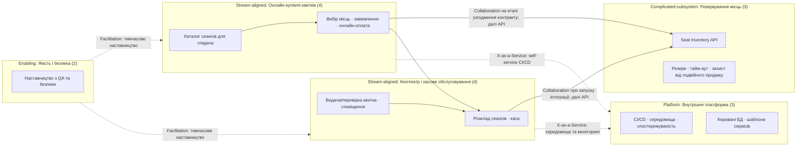

# Завдання 1. Team Topologies, Закон Конвея та RACI

## Контекст продукту

Артефакти адаптовано до системи продажу квитків кінотеатру «Кадр» із попередніх лабораторних робіт: каталог сеансів, місця та їх доступність, оформлення замовлення, продаж через касу/вебсайт/застосунок. Організаційна модель розрахована на 16 інженерів.

## Розподіл команд і модулів

| Команда | Тип | Склад | Відповідальність і модулі |
|---|---|---:|---|
| Онлайн-купівля квитків | Stream-aligned | 4 | Каталог сеансів для глядача, вибір місць у вебі/застосунку, кошик, замовлення та оплата онлайн. |
| Кінотеатр і касове обслуговування | Stream-aligned | 4 | Операції з розкладом сеансів, продаж на касі, видача/перевірка квитка та сповіщення глядачів. |
| Резервування місць | Complicated-subsystem | 3 | Конкурентне резервування місць, блокування подвійного продажу, тайм-аут резерву та API доступності/підтвердження місця. |
| Внутрішня платформа | Platform | 3 | CI/CD, середовища, спостережуваність, керовані бази даних, шаблони сервісів і self-service розгортання. |
| Якість і безпека | Enabling | 2 | Тимчасове наставництво з автотестування, threat modeling, захисту персональних даних і релізної готовності. Команда не стає постійним виконавцем тестів замість продуктових команд. |

### Межі відповідальності та взаємодія

| Режим | Команди | Контракт взаємодії | Критерій завершення / частота |
|---|---|---|---|
| Collaboration | Купівля квитків ↔ Резервування місць | Спільно узгодити API пошуку доступності, створення/скасування резерву, ідемпотентність та поведінку при гонці за останнє місце. | Обмежена discovery/інтеграційним етапом, не більше двох спринтів. Завершується після затвердження OpenAPI-контракту, тестового середовища та проходження контрактних тестів; потім — X-as-a-Service. |
| X-as-a-Service | Продуктові команди → Внутрішня платформа; продуктові команди → Резервування місць після переходу з Collaboration | Документований API/self-service портал, версіоновані контракти, SLA доступності й канал підтримки для інцидентів. | Асинхронно, без регулярних погоджувальних мітингів. Зміни API проходять версіонування та повідомляються споживачам. |
| Facilitation | Якість і безпека → обидві Stream-aligned команди | Практичні сесії та парна робота з тестовою пірамідою, CI quality gates, threat modeling і приватністю даних. | Часова рамка до двох спринтів на команду; завершення, коли команда самостійно підтримує тести й проходить погоджені перевірки. |

### Висновок щодо Закону Конвея

Поділ на дві Stream-aligned команди відображає два наскрізні потоки: онлайн-купівлю квитка та роботу кінотеатру з касовим обслуговуванням. Команда резервування ізолює конкурентну логіку місць за версіонованим API, щоб каса й онлайн-канали не реалізовували власні несумісні правила бронювання. Платформа надає self-service CI/CD та середовища, тому її внутрішні інструменти не стають залежністю для кожного продуктового релізу. Команда якості й безпеки передає практики продуктовим командам, а не створює постійну чергу на централізоване тестування. Така структура має вести до модульних сервісів із чіткими API та окремою відповідальністю за онлайн-замовлення, операції кінотеатру й інвентар місць, а не до спільного зв'язаного моноліту.

### Матриця RACI

Позначення: **R** — виконує роботу, **A** — єдина роль із фінальною відповідальністю, **C** — консультує, **I** — поінформована.

| Процес / артефакт | Product Owner / BA | Project Manager | Tech Lead / Architect | Software Developer | QA Engineer |
|---|---:|---:|---:|---:|---:|
| Проєктування та затвердження вимог (SRS/User Stories) | A/R | C | C | I | C |
| Проєктування архітектури БД та API-контрактів | C | I | A/R | R | C |
| Розробка клієнтського та серверного коду | C | I | A | R | C |
| Code Review та контроль якості коду | I | I | A | R | C |
| Автотести / UAT-валідація | C | I | C | R | A/R |
| Розгортання (Deploy) релізу на Production | I | C | A | R | C |

У рядку тестування QA Engineer є єдиним Accountable за завершення тестового процесу; PO/BA консультує щодо бізнес-критеріїв приймання. Кожен рядок має рівно один **A** і принаймні один **R**.

### ШІ-краш-тест і рефакторинг

Нижче — зафіксований навчальний аудит артефактів (не лог зовнішнього сервісу). Критика перевіряється командою на відповідність продукту, після чого рішення фіксуються окремо.

| ID | Зона | Виявлена прогалина | Ризик | Прийняте виправлення |
|---|---|---|---|---|
| TT-01 | Topologies / Conway | Seat Inventory могло перетворитися на постійне Collaboration між усіма каналами продажу. | Будь-яка зміна резервування вимагатиме спільного планування й блокуватиме релізи. | Обмежити Collaboration двома спринтами та перейти на версіонований API й контрактні тести. |
| TT-02 | Topologies | Централізована команда QA могла б стати обов'язковим ручним гейтом для кожної зміни. | Черга на тестування й передача відповідальності за якість від розробників. | Enabling-команда навчає продуктові команди; автотести й quality gates залишаються у відповідальності stream-команд. |
| TT-03 | RACI | У первинній версії тестового рядка були одночасно PO/BA та QA з роллю A. | Немає єдиного власника рішення про завершення тестування. | Виправлено: один A — QA Engineer для тестового процесу; PO/BA визначає бізнес-критерії та консультує. |

#### Decision Log

| ID | Рішення | Причина | Наслідок |
|---|---|---|---|
| D1 | Встановити часову межу Collaboration для API резервування — максимум два спринти. | Запобігання нескінченній координації продуктових команд. | Після контрактних тестів споживачі працюють через X-as-a-Service. |
| D2 | QA і безпека працюють у режимі Facilitation; продуктові команди володіють тестами та якістю змін. | Уникнення централізованої черги й розмитої відповідальності. | Definition of Done перевіряється в CI та на відповідних середовищах. |
| D3 | Для кожного рядка RACI залишити рівно одного A; для тестового процесу accountable є QA Engineer. | Виправлення конфлікту двох Accountable. | Рішення щодо тестового гейту має визначеного власника. |

### Матеріали для захисту

- Код Mermaid розміщений вище та може бути вставлений у Notion/Confluence у вигляді блоку Mermaid.
- Таблиці взаємодії та RACI можна перенести до BRD, розділ 7.1.
- Перед командним захистом: 1) показати Mermaid-діаграму; 2) пояснити межу Collaboration; 3) показати виправлення RACI й Decision Log.
